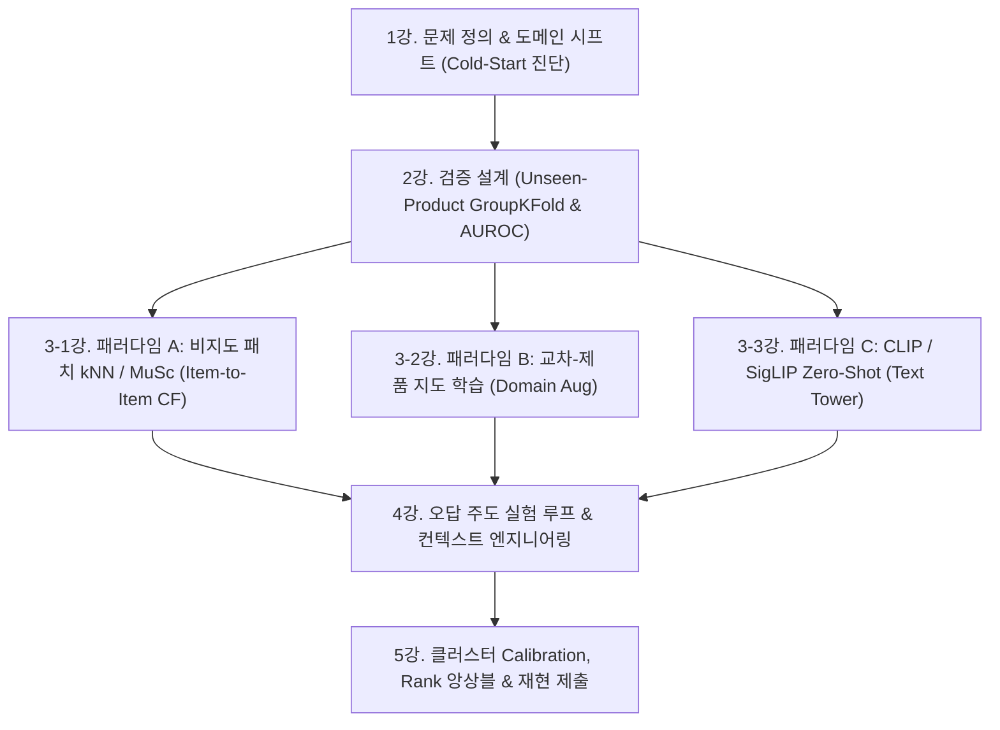
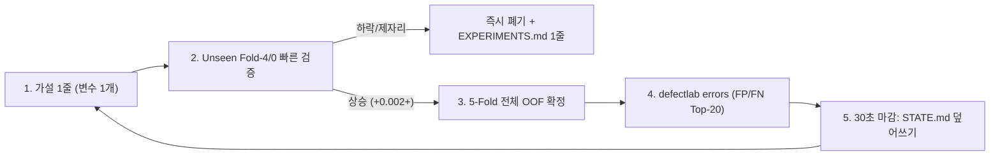
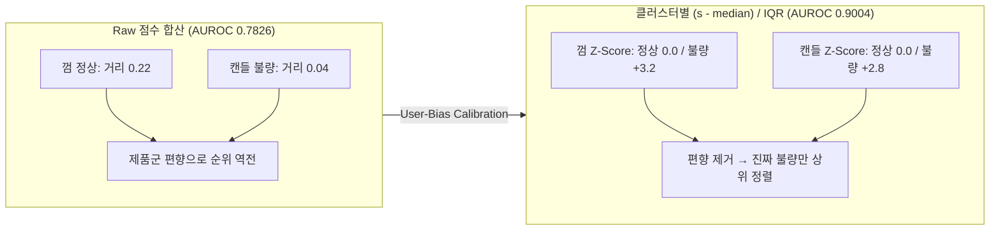

# DKU 2026 불량 탐지 실전 커리큘럼 (RecSys → Zero-Shot Vision Anomaly)

> **설계 원칙**: 이론 나열 금지. 모든 강의는 **[학습 목표 → RecSys 브릿지 → 핵심 원리 & 오개념 → 핸즈온 실습 → 통과 기준(Exit Gate)]**의 동일한 5단계로 체계화한다.
> **연계 파일**: 실전 루프 규칙 [LOOP_PLAN.md](LOOP_PLAN.md) · 현재 상태 [STATE.md](STATE.md) · 실험표 [EXPERIMENTS.md](EXPERIMENTS.md)

---

## 0. 코스 청사진 (Course Blueprint)

| 항목 | 내용 |
|---|---|
| **대상** | RecSys / Tabular ML 경험이 있으나 Vision 이상 탐지 및 대회 루프 운영은 처음인 엔지니어 |
| **핵심 문제** | Train(12종 고정 제품)과 100% 다른 **미학습 제품(Unseen Product)**의 불량을 **AUROC**로 순위 매기기 |
| **총 구성** | 5개 모듈 (7일, 약 15시간 — 이론 30% + 실제 데이터 실험 루프 70%) |
| **최종 산출물** | 누수 없는 Unseen 5-Fold OOF 기반 3-패러다임 Rank 앙상블 + 재현 가능한 제출 코드 (`~2026-11-30 10:00`) |

### 전체 커리큘럼 의존성 지도 (Top-Down Map)



### RecSys → Vision 1:1 개념 브릿지 (Mental Model)

| Vision 이상 탐지 (이 대회) | RecSys 대응 개념 | 핵심 직관 |
|---|---|---|
| 평가 시 처음 보는 미학습 제품 (Unseen Product) | **100% Cold-Start Item / Category** | ID를 외우는 분류기는 서빙 시 즉시 붕괴 |
| Unseen-Product GroupKFold | **Leave-Item-Out / Cold-Start Split** | Random Split은 Warm-Start 누수로 CV 0.99 거짓말 |
| Pretrained Backbone (DINOv2 / ConvNeXt) | **사전학습된 Content Embedding Tower** | 손으로 피쳐를 깎는 대신 범용 임베딩 추출 |
| 전역 평균 풀링 vs 패치 임베딩 (37×37) | **아이템 벡터 1개 vs 1,369개 속성 토큰** | 1개 벡터는 미세 10px 결함을 뭉개지만, 패치는 포착 |
| 비지도 kNN 코사인 거리 (라벨 0개) | **Item-to-Item CF / ANN Retrieval 거리** | 같은 제품 정상 동료 Top-K와 유독 먼 이미지 = 불량 |
| 클러스터별 `(s - median) / IQR` | **User / Category Bias Calibration** | 제품군별 기본 거리 편향 제거 → 전체 AUROC 복구 |
| 패러다임 A + B + C 결합 | **Multi-Source Retrieval + Rank Blending** | CF + Supervised + Text 시그널을 순위로 블렌딩 |

---

## Module 1. 문제 정의 & 도메인 시프트 (Day 1 · 1.5시간)

- **학습 목표**: 코드를 한 줄도 짜기 전에 데이터의 구조적 함정(Cold-Start, 해상도·배경 시프트)을 30분 안에 진단할 수 있다.
- **RecSys 브릿지**: 서빙 트래픽이 100% 신규 상품(Cold-Start)인데, 기존 상품 ID 피쳐로만 모델을 학습하려는 상황을 사전에 차단하는 단계다.
- **핵심 원리 & 오개념**:
  - **생존 EDA 5대 질문 (Train 전용)**: ① 클래스 비율 ② 해상도·종횡비 ③ 중복·그룹 구조 ④ 정상 20 vs 불량 20 시각 대조 ⑤ 제품군 간 배경·조명 차이.
  - **Train 관측 팩트**: Train 10,821장은 8개 직사각형 해상도(`1274~1562px`)의 고정 제품군(마카로니·껌·캔들·캐슈넛·PCB 등)으로 구성된다. **Test 이미지는 육안 열람하지 않고 완전히 격리한다.**
  - **Anti-Pattern (절대 금지)**: 48장 판독 규약 초안 쓰기, 통계표 20개 만들기, Test 이미지를 들여다보고 모델 설계 바꾸기.
- **핸즈온 실습**:
  ```bash
  defectlab profile data/raw/open runs/eda
  defectlab audit-duplicates data/raw/open runs/duplicates
  ```
  `runs/eda/stage_a_normal20.jpg`, `stage_a_defect20.jpg` (Train 전용)를 나란히 열어 눈으로 확인한다.
- **통과 기준 (Exit Gate)**:
  - [ ] [STATE.md](STATE.md)의 "Stage A 생존 EDA 5개 질문"이 모두 1줄씩 채워져 있다.
  - [ ] "왜 이 대회가 일반 이진 분류가 아니라 Zero-Shot 이상 탐지인지" 30초 안에 설명할 수 있다.

---

## Module 2. 검증 설계 & AUROC의 본질 (Day 1 · 1.5시간)

- **학습 목표**: Private LB와 같은 방향으로 움직이는 누수 없는 CV를 구축하고, AUROC의 순위(Ranking) 특성을 이해한다.
- **RecSys 브릿지**: Random Split(Warm-Start 누수)을 버리고 **Cold-Start GroupKFold**를 세우는 과정이며, 유저별 평점 편향이 전체 AUC를 어떻게 망가뜨리는지 이해한다.
- **핵심 원리 & 오개념**:
  - **그룹 단위 분할**: Train의 8개 해상도 그룹을 통째로 묶어 5-Fold(`runs/folds_unseen.json`)를 만들면, 모든 Val Fold가 "학습 시 한 번도 못 본 제품"이 된다.
  - **AUROC = 전체 순위 지표**: 제품 A 내부 AUROC 0.95, 제품 B 내부 AUROC 0.86이어도 두 제품의 점수 스케일이 다르면 합산 AUROC가 0.78로 추락한다.
  - **Anti-Pattern**: Random Stratified K-Fold에서 0.99 찍고 모델이 잘 된다고 착각하기.
- **핸즈온 실습**:
  ```bash
  defectlab folds runs/eda/profile.json runs/folds_unseen.json \
    --n-splits 5 --seed 42 --groups runs/eda/product_resolution_groups.json
  ```
- **통과 기준 (Exit Gate)**:
  - [ ] `runs/folds_unseen.json`에서 5개 Fold 모두 Train/Val 제품군 중복 0%임을 확인했다.
  - [ ] 앞으로 모든 실험의 Keep/Discard 기준을 오직 `runs/folds_unseen.json`의 OOF AUROC로 고정했다.

---

## Module 3. 모델링 3대 패러다임 (Day 2~5 · 8시간)

원리가 다른 3가지 모델을 순서대로 확보한다.

### 3-1강. 패러다임 A: 비지도 패치 이상 탐지 — Item-to-Item CF (Day 2~3 · 4시간)
- **학습 목표**: 학습 라벨 없이(Zero-Label) 사전학습 패치 임베딩만으로 미학습 제품의 미세 결함을 검출한다.
- **RecSys 브릿지**: 같은 제품 클러스터 내 다른 이미지들의 패치를 후보 풀(Candidate Pool)로 두고 ANN/kNN 코사인 거리를 재는 **Item-to-Item CF**다.
- **핵심 원리**:
  - **왜 전역 풀링(E02/E03)을 넘어 패치(E04)로 가야 하는가**: 4구 캔들 중 1개의 10px 찍힘은 전역 평균 풀링에서 1/1000로 희석된다. 반면 `DINOv2` 패치 그리드(예: 37×37 = 1,369 토큰)에서 각 패치의 최근접 이웃 거리를 구하고 상위 `top-p%` 패치 평균을 내면 미세 결함이 그대로 드러난다 (PatchCore / MuSc 원리).
  - **멀티-스케일 피처**: 중간 레이어(국소 텍스처·스크래치) + 최종 레이어(전역 구조·누락)를 결합한다.
- **핸즈온 실습 (Kaggle GPU)**:
  - `E04`: `DINOv2-Large` 패치 kNN(MuSc) + **순수 비지도 클러스터링** 기반 Robust Z-Score를 `runs/folds_unseen.json` 전체 5-Fold에서 실행.
- **통과 기준 (Exit Gate)**:
  - [ ] Unseen Fold-4 AUROC가 `E03(0.9004)`을 명확히 초과하고 5-Fold OOF가 기록됐다.
  - [ ] 해상도 라벨 없이 **비지도 클러스터링**만으로도 스케일 정렬이 작동함을 검증했다.

### 3-2강. 패러다임 B: 교차-제품 지도 학습 (Day 4 · 2시간)
- **학습 목표**: Train 12종의 라벨에서 "제품 정체성"은 버리고 "범용 결함 패턴"만 학습한다.
- **RecSys 브릿지**: Item ID를 뺀 순수 **Content-based Supervised Ranker**를 학습하는 것과 같다.
- **핵심 원리**:
  - **도메인 시프트 파괴 증강**: Train(초록/검정 배경, 직사각형) → Test(회색 배경, 정사각형) 격차를 없애기 위해 `Grayscale`, 강한 `ColorJitter`, `RandomResizedCrop(1:1)`을 적용한다.
  - **실습**: `configs/exp01_convnext_s_384.toml` 기반으로 `augment = "strong"`, `resize_mode = "stretch"`를 `runs/folds_unseen.json`에서 5-Fold 검증.
- **통과 기준 (Exit Gate)**:
  - [ ] 교차-제품 지도 모델이 Unseen 5-Fold에서 `E01(0.7408)`을 크게 상회하고 OOF 예측 JSON을 저장했다.

### 3-3강. 패러다임 C: Vision-Language Zero-Shot — CLIP / SigLIP (Day 5 · 2시간)
- **학습 목표**: 텍스트 프롬프트로 "결함"의 의미론적 개념을 주입해 패러다임 A·B와 다른 오류 패턴을 확보한다.
- **RecSys 브릿지**: 아이템 설명 텍스트를 쓰는 **Semantic Text Tower**다.
- **핵심 원리**: 2026-11-15 이전 공개 오픈소스 CLIP/SigLIP으로 `"normal intact industrial part"` vs `"damaged scratched broken chipped defective part"` 텍스트 앙상블과 이미지/패치 유사도 차이를 계산한다.
- **통과 기준 (Exit Gate)**:
  - [ ] CLIP/SigLIP Zero-Shot OOF 예측 JSON이 생성되고, 패러다임 A와의 예측 상관계수가 0.90 미만(다양성 확보)임을 확인했다.

---

## Module 4. 오답 주도 실험 루프 & 컨텍스트 엔지니어링 (Day 2~6 상시 · 2시간)

- **학습 목표**: 감으로 튜닝하지 않고, 매 루프 오답 40장만 보고 다음 변수 1개를 결정하며 AI와 문맥을 잃지 않고 협업한다.
- **핵심 루프 흐름**:



- **오답 → 다음 액션 의사결정표**:
  - FP/FN이 특정 제품군에 몰림 → **클러스터링/Calibration 개선**
  - FN에 미세 찍힘/스크래치가 뭉개져 보임 → **해상도 상향 또는 패치 토큰 추출**
  - FP에 조명 반사/배경 노이즈가 많음 → **ColorJitter/Grayscale 증강 강화**
  - 특정 패러다임의 구조적 한계 → **다른 패러다임(A↔B↔C) 추가**
- **AI 컨텍스트 유지 30초 의식**:
  - 새 세션은 `AGENTS.md` → `STATE.md` → `EXPERIMENTS.md` 3개만 읽고 `defectlab brief` 실행.
  - 루프 종료 시 `EXPERIMENTS.md` 1줄 추가 + `STATE.md` 덮어쓰기(50줄 이내).
- **통과 기준 (Exit Gate)**:
  - [ ] `EXPERIMENTS.md`에 최소 8개 이상의 가설·수치·판정·오답 관찰이 1줄씩 누적되어 있다.

---

## Module 5. Calibration, Rank 앙상블 & 재현 제출 (Day 6~7 · 2시간)

- **학습 목표**: 이종 패러다임(A+B+C)의 점수를 편향 없이 결합하고, 코드 검증을 100% 통과하는 최종 제출물을 완성한다.
- **Calibration 원리 시각화**:



- **핵심 원리 & 주의점**:
  - **소규모 클러스터 함정**: 클러스터 크기가 너무 작으면(예: 10장 미만) `median/IQR` 분산이 커지므로 전역 분포와 혼합하는 Shrinkage를 OOF로 검증한다.
  - **Rank / Logit 앙상블**: 패러다임 A(거리), B(확률), C(코사인 유사도)는 스케일이 완전히 다르므로 `defectlab ensemble --method rank`로 결합한다.
- **핸즈온 실습**:
  ```bash
  defectlab ensemble runs/final/oof_ens.json \
    runs/e04_dinov2_patch/oof.json runs/e06_sup/oof.json runs/e07_clip/oof.json \
    --weights 0.5 0.3 0.2 --method rank
  defectlab reproduce runs/final/sub_run1.csv runs/final/sub_run2.csv \
    --probability-atol 1e-5 --auroc-atol 0
  ```
- **통과 기준 (Exit Gate)**:
  - [ ] 앙상블 OOF AUROC가 모든 단일 모델 OOF AUROC를 상회한다.
  - [ ] Clean 환경에서 학습/추론 재현 완료, 모든 사전학습 가중치(2026-11-15 이전) 출처·버전·라이선스 명기 완료.

---

## 6. 자가 진단 루브릭 (Mastery Rubric)

| 레벨 | 상태 진단 | 다음으로 넘어가기 위해 할 일 |
|---|---|---|
| **Level 1 (입문)** | Random Split으로 ResNet 학습 중, 문서/설정에 시간 소모 | **1강 + 2강** 완료 (`runs/folds_unseen.json` 고정) |
| **Level 2 (기초)** | Unseen CV 구축 완료, 전역 풀링 + Calibration으로 `0.90` 달성 | **3-1강** 실행 (DINOv2 패치 kNN + 비지도 클러스터링) |
| **Level 3 (중급)** | 패치 기반 비지도 모델 OOF `0.95+` 달성, `defectlab errors`로 매 루프 개선 | **3-2강 + 3-3강** (이종 패러다임 B, C 확보) |
| **Level 4 (실전 완성)** | A+B+C Rank 앙상블 OOF 최고점 경신 + Clean 재현 코드 및 라이선스 문서화 완료 | 최종 제출 마감 (`2026-11-30 10:00`) |
