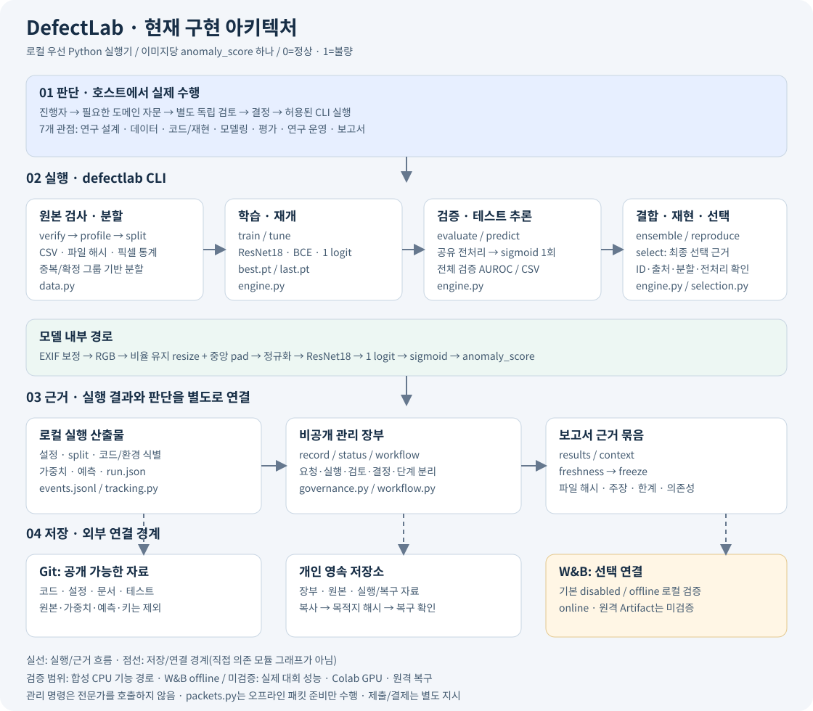

# DKU 제품 이미지 불량 탐지 연구 도구

제품 이미지에서 이미지당 `anomaly_score`(불량 점수) 하나를 만드는 가벼운 Python 연구 도구다. 현재 모델은 sigmoid로 0~1 점수를 출력하며, 확률 보정 여부는 검증하지 않았다. 라벨은 `0=정상`, `1=불량`이며 전체 검증 예측으로 AUROC를 계산한다. 공개 저장소에는 데이터·가중치·예측·인증정보를 넣지 않는다.

새 에이전트는 [운영 진입점](docs/OPERATIONS.md)에서 시작해 [현재 상태와 증거](docs/CURRENT-STATUS.md)를 확인한다. 진행자가 도메인 자문·독립 검토·결정·실행·인계를 연결한다. `record`는 실제 전문가 호출을 대신하지 않는다.

v0.1은 데이터 검사/픽셀 카탈로그/중복 그룹 분할, ResNet18 학습·epoch 경계 재개·고정 가중치 평가·CSV 추론, 작은 순차 튜닝·확률 앙상블·재현 검사, 로컬/W&B 기록, 관리 장부·보고서 근거 묶음을 제공한다. 실제 대회 GPU 학습·성능 측정·제출은 아직 수행하지 않았다. 무료 Colab GPU와 W&B cloud 연결도 미검증이다.

## 아키텍처 한눈에 보기



이 그림은 현재 소스와 운영 절차를 기준으로 한다. [기반 선택 당시의 설계 비교](docs/ARCHITECTURE.md)와 달리, 원격 연결 성공이나 연구 완료를 뜻하지 않는다.

전체 구조는 **판단 → 실행 → 근거 확인**으로 이어진다.

1. **진행자가 연구를 운영한다.** 필요한 도메인에 자문하고 별도 독립 검토를 거쳐 다음 실험을 결정한다. 연구 설계·데이터·코드/재현·모델링·평가·연구 운영·보고서의 7개 관점을 사용하며, 매번 전부 호출하지 않는다.
2. **Python CLI가 명시된 작업을 실행한다.** 원본 검사와 분할, 학습과 재개, 평가와 추론을 작은 명령으로 나눈다. 기본 설치에는 무거운 학습 의존성이 없으며, 필요한 명령에서만 해당 모듈을 불러온다.
3. **결과와 판단을 별도 근거로 연결한다.** 실행 산출물과 비공개 장부에 해시와 의존성을 남긴다. 과거 실행 완료, 현재 근거 유효성, 영속 저장, 새 세션 복구는 각각 확인한다. 미관측 값은 `null/unknown`이다.

### 데이터에서 점수까지

`verify → profile → split → train → evaluate / predict`가 기본 경로다. `tune`은 제한된 후보를 순차 실행하며, 필요한 경우 `ensemble → reproduce → select`로 결합·재현·최종 선택 근거를 남긴다. `select`와 CSV 생성은 대회 제출을 수행하지 않는다.

원본은 읽기 전용으로 취급한다. 분할에는 이미지 ID·라벨·그룹·데이터 해시를 기록하고, 학습·평가·추론에서 원본과의 일치를 검사한다. 확정한 촬영/제품 그룹을 추가할 수 있지만, 정확히 같은 이미지의 중복 분리만으로 데이터 독립성이 보장되지는 않는다.

현재 baseline은 이미지 전체를 처리하는 **ResNet18 이진 분류기**다.

```text
이미지 → EXIF 보정·RGB 변환 → 비율 유지 resize·중앙 pad
       → 고정 정규화 → ResNet18 → 1 logit → sigmoid → anomaly_score
```

학습 손실은 BCE이며 학습 중 검증·별도 평가·테스트 추론이 전처리를 공유한다. 제품 개수와 관계없이 이미지당 점수 하나를 출력한다. 기본은 무작위 초기화이며 사전학습 가중치를 자동 다운로드하지 않는다. `best.pt`는 전체 검증 AUROC가 가장 높은 가중치, `last.pt`는 optimizer·난수·epoch 상태를 포함한 epoch 경계 재개용 checkpoint다.

### 모듈별 책임

| 위치 | 책임 | 주요 명령·산출물 |
|---|---|---|
| `src/defectlab/cli.py` | 명령 인자와 모듈 분기 | `defectlab --help` |
| `src/defectlab/data.py` | 원본 검사·픽셀 조사·그룹 분할 | `verify`, `profile`, `split` |
| `src/defectlab/engine.py` | 전처리·학습·재개·평가·추론·결합·재현 | `train`, `tune`, `evaluate`, `predict`, `ensemble`, `reproduce` |
| `src/defectlab/selection.py` | 검증·테스트 출처와 재현 기록을 연결한 선택 | `select` |
| `src/defectlab/tracking.py` | 로컬 이벤트와 선택적 W&B 기록 | `events.jsonl`, Artifact 영수증 |
| `src/defectlab/governance.py` | 장부·의존성·결과표·보고서 근거 관리 | `record`, `status`, `results`, `context`, `freshness`, `freeze` |
| `src/defectlab/workflow.py` | 계획과 현재 장부를 읽어 다음 행동 안내 | `workflow` — 읽기 전용 |
| `src/defectlab/packets.py` | Pro 자문용 오프라인 패킷 준비 | 명세·원본 사본·해시, 전송 없음 |
| `src/defectlab/common.py` | 파일/JSON 해시·안전한 경로·설정 입출력 | 공통 기반 |

관리 명령은 전문가를 자동 호출하지 않는다. 실제 자문과 독립 검토는 호스트의 에이전트 호출 도구로 수행한 뒤 기록한다. `workflow`도 다음 행동만 안내하며, `freeze`는 근거 묶음을 고정하고 보고서 원고를 생성하지 않는다.

### 실행·저장 위치

| 위치 | 담는 것 | 현재 경계 |
|---|---|---|
| Git 저장소 | 코드·공개 설정·문서·테스트·Colab notebook | 원본·가중치·예측·키·비공개 경로 제외 |
| 로컬 또는 무료 Colab | CLI 실행과 비공개 `runs/` 산출물 | CPU 기능 경로 검증, 실제 Colab GPU 미검증 |
| 개인 영속 저장소 | 원본·장부·checkpoint·복구 근거 | 복사 후 목적지 해시와 새 세션 복구를 따로 확인 |
| W&B 선택 연결 | 실험 지표·명시한 모델 Artifact | 기본 `disabled`; `offline` 로컬 검증, cloud 미검증 |

## 설치와 첫 실행

```bash
python -m venv .venv
source .venv/bin/activate
python -m pip install -e '.[data,vision,tracking,dev]'
defectlab --help
```

관리·보고서만 필요하면 `python -m pip install -e .`로 설치한다. PyTorch는 실행 환경에 맞는 CPU/CUDA 빌드를 먼저 설치할 수 있다. [정확한 실행·복구 절차](docs/RUNBOOK.md), [Colab notebook](notebooks/colab.ipynb), [환경 기록](requirements-verified-cpu.txt), [실제 검증 범위](docs/IMPLEMENTATION-VALIDATION.md)를 참고한다.

### 기본 실행 순서

```bash
defectlab verify data/raw/open --manifest /path/to/private-manifest.json
defectlab profile data/raw/open runs/eda
defectlab split runs/eda/profile.json runs/split.json
defectlab train data/raw/open runs/split.json configs/baseline.toml runs/baseline
```

`configs/baseline.toml`은 CUDA 출발 설정이다. CPU에서는 `device="cpu"`, `amp=false`로 별도 설정을 만든다. 256 입력의 적절성·근접 중복·촬영 종속성은 연구로 확인해야 한다. exact duplicate 분리가 독립성을 보증하지 않는다.

원본은 `train.csv`, `train/`, `sample_submission.csv`, `test/`를 포함하는 로컬 디렉터리로 전달한다. 원본을 수정하지 않는다. 검증 manifest는 데이터 소유자가 비공개로 전달하며 기본 공개 manifest로 강제하지 않는다.

## 데이터와 실행 규칙

제공 학습 데이터만 학습하고 테스트 정답·외부 원본/공개 라벨을 조회하지 않는다. 원격 모델 추론 API를 사용하지 않는다. 사전학습은 2026-11-15까지 공개된 가중치의 출처·버전·라이선스·해시를 확인한 로컬 파일만 허용한다. 기본은 무작위 초기화다. 대회 제출과 GPU 결제는 자동 수행하지 않는다.

## Pro 보조 EDA와 관련 문서

[지금까지 한 일](docs/research/WORK-SUMMARY-2026-11-18.md)에서 실제 관측과 미완료 작업을 구분한다. [EDA 노트북](notebooks/eda.ipynb)은 기존 카탈로그·익명 판독 기록을 읽어 통계·관측 메모·재판독 차이를 보여 준다. `pip install -e '.[notebook]'` 후 `jupyter lab notebooks/eda.ipynb`로 연다. 비공개 입력 경로는 첫 설정 셀에서 지정하며, 실행 출력·사진을 포함한 사본은 `runs/`에 보관하고 공개 원본은 출력 없이 유지한다.

CV EDA 용어가 익숙하지 않다면 노트북0절과 각 절의 해설, [이진 분류·EDA 읽기 안내](docs/research/BINARY-CLASSIFICATION-EDA-GUIDE.md)를 먼저 읽는다. 제품 유형·실물 촬영 관계·0/1 목표 라벨·제품 수 관측을 구분하고, 불균형 처리와 검증의 조건을 설명한다.

Pro를 최초 분석자로 쓰는 파일럿은 [단계별 실행·재개 계획](docs/PRO-ASSISTED-EDA.md)을 따른다. `workflow`는 다음 행동을 조회하고, 오프라인 패킷 도구는 전송 자료만 준비한다. 실제 Pro 연결·이미지 업로드는 별도 근거가 필요하다.

설계와 연구 책임은 [계획](docs/PLAN.md), [아키텍처](docs/ARCHITECTURE.md), [관리 하네스](docs/MANAGEMENT-HARNESS.md), [보고서 문맥](docs/REPORT-CONTEXT-HARNESS.md)에 보존한다. 이 문서들의 과거 설계 상태 설명은 당시 이력이며 현재 실행 계약은 RUNBOOK과 소스·테스트를 따른다. 미래 연구 하네스의 역할별 LLM 모델·effort는 아직 미정이다.

## 개발 검사

```bash
python scripts/check_text.py
.venv/bin/ruff check .
.venv/bin/pytest
```

커밋 전에는 `python scripts/check_text.py --staged`도 실행한다. 실제 검증 기록과 미검증 범위는 [현재 상태](docs/CURRENT-STATUS.md)와 [구현 검증 범위](docs/IMPLEMENTATION-VALIDATION.md)에서 확인한다.
