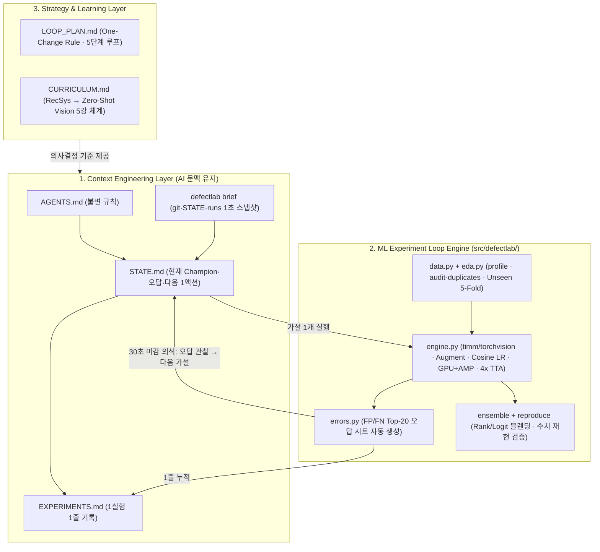

# DKU 제품 이미지 불량 탐지 대회 — 실전 루프 & 컨텍스트 하네스

미학습 제품(Unseen-Product)의 외관 이미지에서 `anomaly_score`(`0=정상`, `1=불량`)를 예측하고 **Unseen 5-Fold OOF AUROC**를 극대화하기 위한 경량 ML 실험·컨텍스트 엔지니어링 하네스다.

> **핵심 진입점**:
> - AI 부팅 & 작업 메모리: [AGENTS.md](AGENTS.md) → [STATE.md](STATE.md) → [EXPERIMENTS.md](EXPERIMENTS.md)
> - 실전 루프 가이드 & 체계화 커리큘럼: [LOOP_PLAN.md](LOOP_PLAN.md) · [CURRICULUM.md](CURRICULUM.md)
> - 대회 규정 & 데이터 설명: [research/competition-rules.md](research/competition-rules.md) · [research/data-description.md](research/data-description.md)

---

## 시스템 아키텍처 (3-Layer Architecture)

복잡한 장부·관료주의를 제거하고 **① 컨텍스트 계층 ② ML 실험 루프 엔진 계층 ③ 전략·커리큘럼 계층**의 3단 구조로 설계했다.



### 각 계층의 역할

1. **Context Engineering Layer (문맥 드리프트 차단)**
   - 새 AI 세션은 `AGENTS.md` → `STATE.md` → `EXPERIMENTS.md` **딱 3개 파일(총 100줄 미만)**만 읽고 시작한다.
   - `defectlab brief`가 `git HEAD`, `STATE.md` 비대화 여부, `EXPERIMENTS.md` 최근 행, `runs/` 내 실제 최고 `run.json`과 `errors.json`을 `torch` 임포트 없이 1초 만에 집계한다.
   - 매 루프 종료 시 **30초 마감 의식**(`EXPERIMENTS.md` 1줄 추가 + `STATE.md` 덮어쓰기)만 수행하고, 새 요약 문서를 남발하지 않는다.
2. **ML Experiment Loop Engine (`src/defectlab/`)**
   - **누수 차단 CV (`data.py`)**: `defectlab folds`로 혼합 라벨 그룹(제품군·해상도)을 지원하는 **Unseen-Product StratifiedGroupKFold** 생성.
   - **고속 학습·추론 (`engine.py`)**: `torchvision` 4종 + `timm:<model_name>` 지연 임포트, `basic`/`strong` 증강, `pad`/`stretch` 리사이즈, `Cosine + Warmup` 스케줄러, `num_workers >= 0`, GPU+AMP 평가/추론, `--fast` 검증, 4x `--tta`, AUROC 특화 `--method prob|rank|logit` 앙상블 지원.
   - **오답 주도 EDA (`errors.py`)**: `defectlab errors` 한 줄로 `fp_top20.jpg` / `fn_top20.jpg`를 생성해 다음 가설을 눈으로 도출한다.
3. **Strategy & Learning Layer**
   - [LOOP_PLAN.md](LOOP_PLAN.md): Stage A 30분 생존 EDA, Stage B 오답 주도 EDA, 5단계 기계적 실험 루프.
   - [CURRICULUM.md](CURRICULUM.md): RecSys 엔지니어를 위한 1:1 개념 브릿지(Cold-Start, Item-to-Item CF, User-Bias Calibration)와 5강 핸즈온 커리큘럼.

---

## 핵심 명령어

```bash
# 0. AI 세션 부팅 스냅샷 (1초, torch 미임포트)
defectlab brief

# 1. Stage A: 30분 생존 EDA + Unseen-Product 5-Fold 생성
defectlab profile data/raw/open runs/eda
defectlab audit-duplicates data/raw/open runs/duplicates
defectlab folds runs/eda/profile.json runs/folds_unseen.json \
  --n-splits 5 --seed 42 --groups runs/eda/product_resolution_groups.json

# 2. Fold-0 빠른 검증 (Pretrained + Cosine LR + Basic Aug + Fast GPU I/O)
defectlab train data/raw/open runs/folds_unseen.json configs/exp01_convnext_s_384.toml runs/exp01/fold0 --fold 0 --fast
defectlab evaluate data/raw/open runs/folds_unseen.json runs/exp01/fold0/best.pt runs/exp01/val_fold0.json --fold 0 --fast

# 3. Stage B: 오답 주도 EDA (FP Top-20 / FN Top-20 시트 자동 생성)
defectlab errors data/raw/open runs/exp01/val_fold0.json runs/exp01/errors --top-k 20

# 4. 추론 (GPU + 4x TTA) 및 AUROC 특화 앙상블 (prob / rank / logit)
defectlab predict data/raw/open data/raw/open/sample_submission.csv runs/exp01/fold0/best.pt runs/exp01/sub.csv --tta --fast
defectlab ensemble runs/ens/val.json runs/exp01/val_fold0.json runs/exp02/val_fold0.json --weights 0.5 0.5 --method rank
```

---

## 모듈 구조

| 위치 | 책임 | 주요 명령 |
|---|---|---|
| `src/defectlab/cli.py` | 경량 CLI 진입점 (지연 임포트) | `defectlab --help` |
| `src/defectlab/brief.py` | AI 세션 부팅용 컨텍스트 스냅샷 | `brief` |
| `src/defectlab/data.py` | 원본 검사·프로파일·혼합 라벨 Stratified Group K-Fold | `verify`, `profile`, `split`, `folds` |
| `src/defectlab/eda.py` | 중복 감사·해상도 변환 비교 | `audit-duplicates`, `compare-transforms` |
| `src/defectlab/errors.py` | 오답 주도 EDA (FP/FN Top-K 접촉 시트) | `errors` |
| `src/defectlab/engine.py` | `torchvision`/`timm` 학습·증강·Cosine LR·TTA·Rank/Logit 앙상블 | `train`, `evaluate`, `predict`, `ensemble`, `reproduce`, `tune` |
| `src/defectlab/tracking.py` | 로컬 `events.jsonl` 및 선택적 W&B 기록 | `events.jsonl` |
| `src/defectlab/common.py` | 파일/JSON 해시·안전한 경로·TOML/JSON 설정 | 공통 기반 |

---

## 설치 및 개발 검사

```bash
python -m venv .venv
source .venv/bin/activate
python -m pip install -e '.[data,vision,dev]'
# Kaggle/Colab에서 timm 백본 사용 시:
# pip install timm

python scripts/check_text.py
.venv/bin/ruff check .
.venv/bin/pytest
```

## 대회 규정 경계

- `data/raw/open` 원본은 읽기 전용이며 수정하지 않는다.
- 제공 학습 데이터만 학습한다. 테스트 정답·외부 데이터/라벨 조회 및 원격 모델 API 추론을 금지한다.
- 사전학습 가중치는 **2026-11-15 이전 공개 오픈소스**만 사용하며, 최종 코드 제출 시 버전·출처·라이선스를 명시한다.
- 데이터·가중치(`.pt`/`.pth`)·예측 CSV·API 키·절대 경로·`runs/`는 Git에 커밋하지 않는다.
