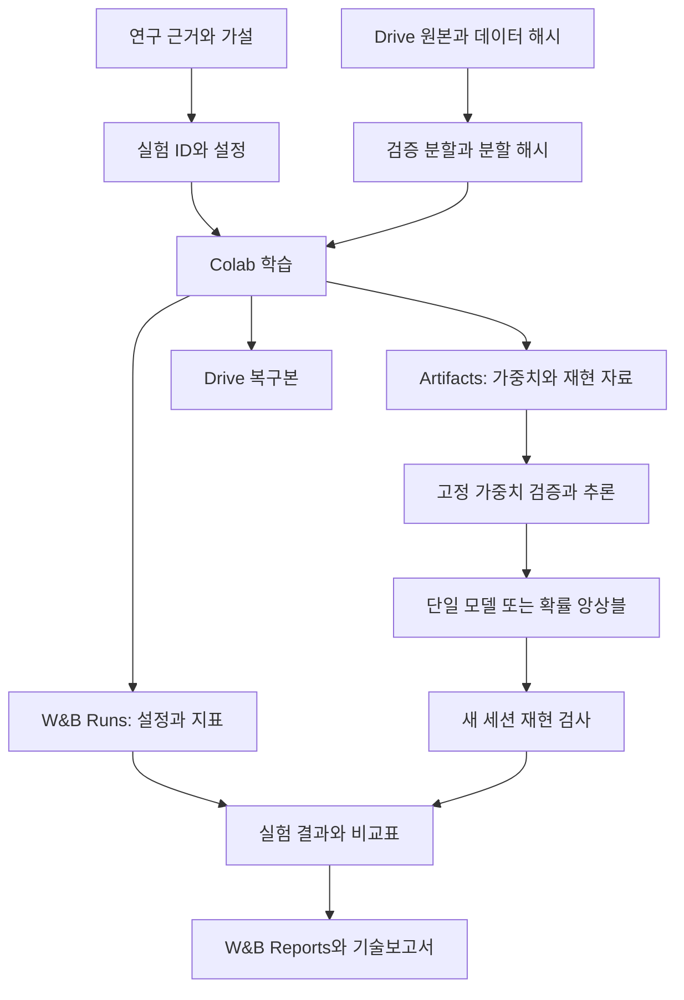

# 가벼운 연구 관리 기반 선택

2026-11-17 확인. 최종 도입은 아직 설계 제안이다.

| 후보 | 실제 담당 범위 | 현재 판단 |
|---|---|---|
| [CCDS](https://github.com/drivendataorg/cookiecutter-data-science) | 폴더·환경·실행 명령 템플릿 | 폴더 역할과 작은 명령 구성을 참고 |
| [Lightning-Hydra Template](https://github.com/ashleve/lightning-hydra-template) | Hydra 설정 조립, Lightning Trainer, callback/logger | 학습 공통화 필요성이 커질 때 재검토 |
| [DVC](https://doc.dvc.org/start/data-pipelines) | 파일 의존성·단계 재실행·산출물 버전 | 현재 Drive+W&B 구성에 추가할 근거가 생기면 도입 |

서로 같은 범위의 대체재가 아니다. 초기 제안은 Git의 코드·설정·연구 기록, Colab의 직접 학습·추론, W&B Runs/Artifacts/Reports, Drive 원본·복구본을 작은 Python 실행 경로로 연결하는 것이다. CCDS만으로 학습·재현·보고서 자동화가 완성되는 것은 아니다.

W&B Artifact 버전을 고정 가중치 평가 run의 입력으로 기록하면 생성·소비 관계를 남길 수 있다. 저장만으로 재현에 성공한 것으로 처리하지 않는다.

## 확인한 원본 코드

- CCDS commit `17c991b0b03668f6e36503a4416202900196f501`: 템플릿 Makefile·pyproject와 폴더 역할. [공식 구조](https://cookiecutter-data-science.drivendata.org/#directory-structure). 템플릿 전체를 복사하지 않았으며 아직 학습 scaffold도 도입하지 않았다.
- Lightning-Hydra commit `bddbc24b82ab6ccfa6243e815a49dc5bfe8d4144`: [train.py](https://github.com/ashleve/lightning-hydra-template/blob/bddbc24b82ab6ccfa6243e815a49dc5bfe8d4144/src/train.py), configs/train.yaml, configs/logger/wandb.yaml. 이 템플릿의 라벨 있는 test 평가와 대회의 라벨 없는 test 추론은 구분해야 한다.
- DVC 공식 예제 commit `06ea48980a34ef57041c9b905cafcb40d9c3ddbc`: [dvc.yaml](https://github.com/iterative/example-get-started/blob/06ea48980a34ef57041c9b905cafcb40d9c3ddbc/dvc.yaml). 원본은 텍스트 분류 예제이며 이미지 대회용 모델이 아니다.

## W&B 근거와 확인 한계

- [Artifacts 생성·버전](https://github.com/wandb/docs/blob/main/models/artifacts/construct-an-artifact.mdx).
- [Artifact 입력·다운로드·검증](https://github.com/wandb/docs/blob/main/models/artifacts/download-and-use-an-artifact.mdx).
- [Reports 작성](https://github.com/wandb/docs/blob/main/models/reports/create-a-report.mdx), [PDF·LaTeX 내보내기](https://github.com/wandb/docs/blob/main/models/reports/clone-and-export-reports.mdx).
- [run 재개](https://github.com/wandb/docs/blob/main/models/runs/resuming.mdx), [지표 기록](https://github.com/wandb/docs/blob/main/models/track/log.mdx), [환경 변수와 업로드 설정](https://github.com/wandb/docs/blob/main/models/track/environment-variables.mdx).

W&B 공식 웹 문서의 이전 URL은 리디렉션 접근에 실패하여 공식 문서 저장소 원문으로 확인했다. 이 저장소는 2026-09-30 archive 상태다. 실제 계정의 접근 범위·Artifact 저장 용량과 설치 SDK 동작은 연결 시 확인해야 한다. 서비스 사용과 성능을 실측한 보고서가 아니다.

- [PyTorch 재현성](https://docs.pytorch.org/docs/2.15/notes/randomness.html): seed와 환경을 기록하되 플랫폼 간 완전 일치를 보장하지 않는다.
- [PyTorch checkpoint](https://docs.pytorch.org/tutorials/beginner/saving_loading_models.html): 학습 재개 상태와 추론 가중치를 구분한다.
- [scikit-learn 그룹 검증](https://scikit-learn.org/stable/modules/cross_validation.html#cross-validation-iterators-for-grouped-data): 종속 개체가 양쪽에 섞이지 않도록 한다.
